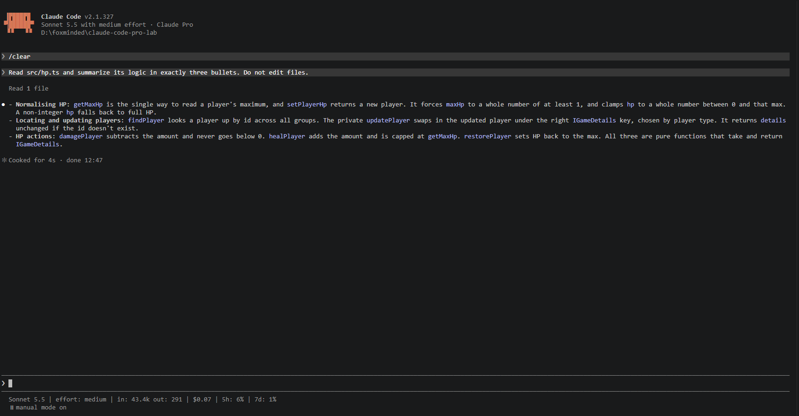
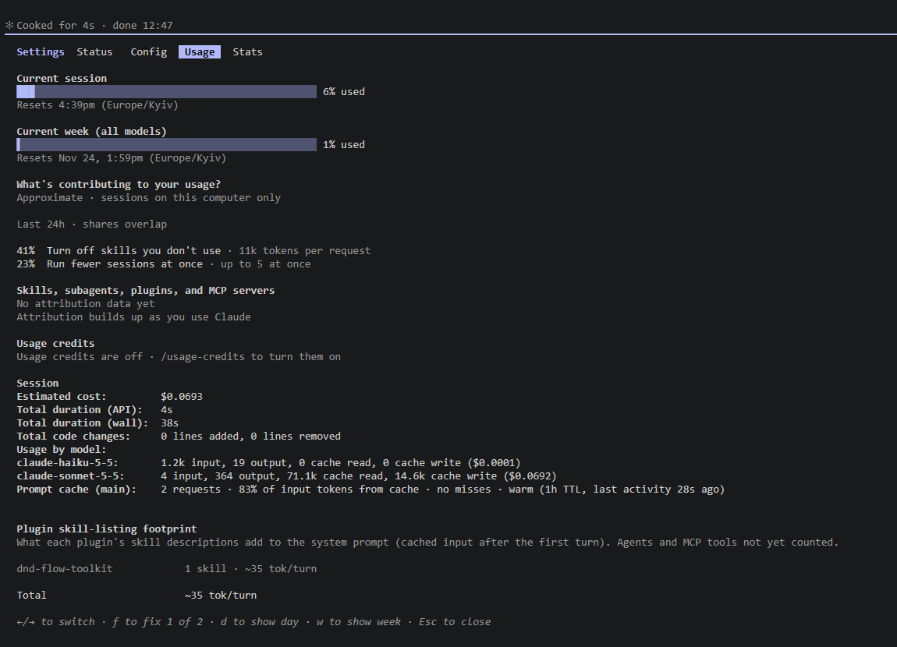
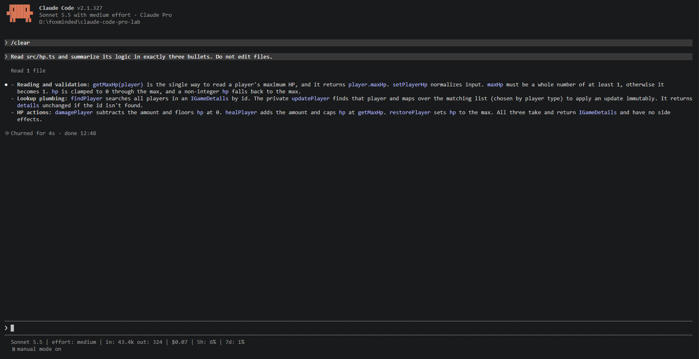
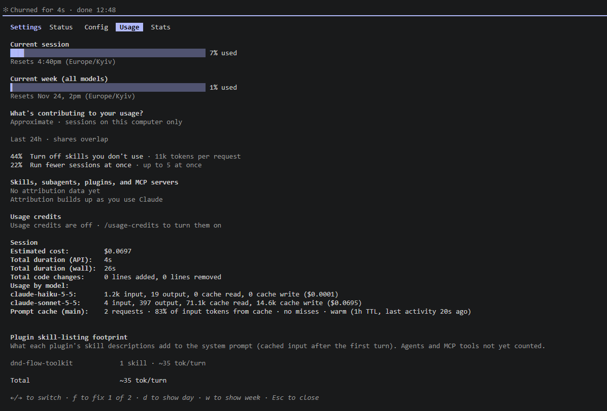
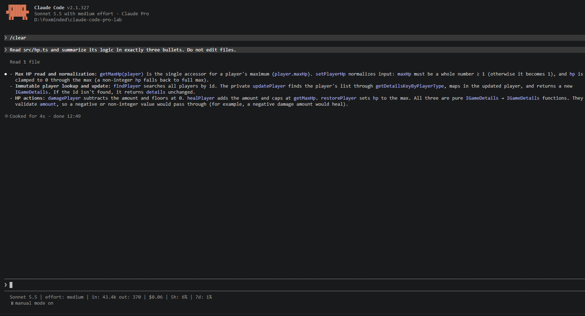
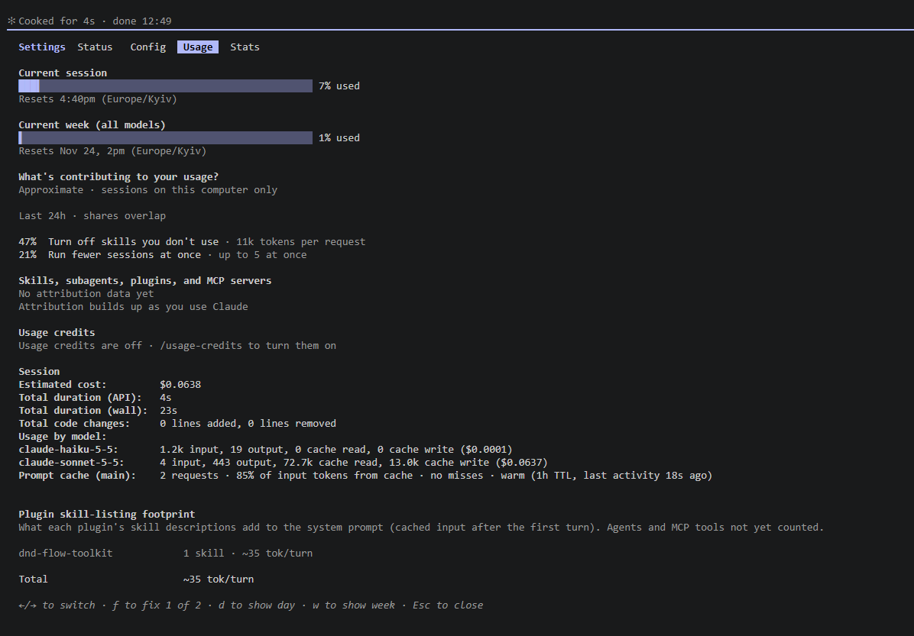

# Задача 10.2 — «Базова лінія»

## Метод

Для кожного запуску використовується та сама коротка read-only задача, модель Sonnet 5.5 і рівень effort medium. Після кожного запуску записуються значення з `/usage`. Вартість у statusline та `/usage`.

## Виміри

| № | Задача | Input | Cache read | Cache write | Output | Input разом* | Оцінка вартості |
|---:|---|---:|---:|---:|---:|---:|---:|
| 1 | Підсумувати логіку `src/hp.ts` у трьох пунктах, без редагування | Sonnet 4; Haiku 1.2k | 71.1k | 14.6k | Sonnet 364; Haiku 19 | ≈86.9k | **$0.0693** |
| 2 | Та сама задача після `/clear` | Sonnet 4; Haiku 1.2k | 71.1k | 14.6k | Sonnet 397; Haiku 19 | ≈86.9k | **$0.0697** |
| 3 | Та сама задача після `/clear` | Sonnet 4; Haiku 1.2k | 72.7k | 13.0k | Sonnet 443; Haiku 19 | ≈86.9k | **$0.0638** |

\* Сума input + cache read + cache write; `/usage` округлює частину токенів до `k`. У всіх трьох запусках було по два запити prompt cache без промахів: 83%, 83% і 85% input з кешу. Statusline показав `$0.07`, `$0.07` і `$0.06`; `/usage` дав точніші локальні оцінки. `in: 43.4k` у statusline стосується останньої відповіді, а не сумарних токенів запуску.

Середня локальна оцінка — **$0.0676 за запуск**; округлений обсяг input + cache read/write у кожному — близько **86.9k токенів**. Різницю вартості пояснює зміна частки читання й запису кешу.

## Докази

Запит і statusline після запуску 1:

Usage після запуску 1:

Запит і statusline після запуску 2:

Usage після запуску 2:

Запит і statusline після запуску 3:

Usage після запуску 3:

