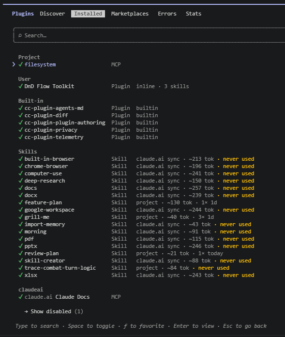

# Задача 8.3 — «Плагін»

## Структура

У теці завдання є звіт, скриншот завантаженого плагіна й корінь самодостатнього плагіна:

```text
fox_hws/8.3/
├── report.md
├── image.png                         ← плагін, завантажений у сесію
└── dnd-flow-toolkit/                 ← корінь плагіна
    ├── .claude-plugin/
    │   └── plugin.json               ← тут лише маніфест
    ├── commands/
    │   └── review-plan.md
    ├── hooks/
    │   └── hooks.json
    ├── scripts/
    │   ├── format-after-edit.mjs
    │   └── protect-files.mjs
    ├── skills/
    │   ├── feature-plan/SKILL.md
    │   └── grill-me/SKILL.md
    └── README.md
```

## Компоненти та namespace

- Маніфест задає plugin name `dnd-flow-toolkit` і шляхи `./skills/` та `./commands/`. Хуки завантажуються зі стандартного `hooks/hooks.json`.
- Основний skill: `/dnd-flow-toolkit:feature-plan`. Його залежність `grill-me` включена в плагін як `/dnd-flow-toolkit:grill-me`, тож основний skill не покладається на окрему користувацьку інсталяцію.
- Slash-команда: `/dnd-flow-toolkit:review-plan <plan-number>`.
- `PreToolUse` запускає захисний хук до `Edit|Write`; `PostToolUse` запускає форматер і лінтер після `Edit|Write`.
- Hook config викликає скрипти через `${CLAUDE_PLUGIN_ROOT}`. Обидва скрипти визначають цільовий репозиторій через `CLAUDE_PROJECT_DIR`, тому їхні шляхи не залежать від розташування плагіна.

Усі файли плагіна містяться під `dnd-flow-toolkit/`; його можна перенести в окремий Git-репозиторій і підключити до цільового проєкту без посилань на батьківські теки цього репозиторію.

Файли skill, команди й хуків скопійовані в плагін; імпортів або шляхів до їхніх оригіналів у `.claude/` немає. Єдина залежність від цільового проєкту — встановлені локально CLI Prettier, ESLint і Stylelint, які форматувальний хук шукає під `CLAUDE_PROJECT_DIR/node_modules`.

## Перевірка

`claude plugin validate ./fox_hws/8.3/dnd-flow-toolkit` завершився з `Validation passed`. 
Валідатор показав необов'язкове попередження, що в плагіна немає marketplace-іконки; для локального завантаження з теки вона не потрібна. 
Також окремо перевірено JSON маніфесту й hook config та синтаксис обох Node.js-скриптів. 
Скриншот зроблено після запуску `claude --plugin-dir ./fox_hws/8.3/dnd-flow-toolkit`; він підтверджує, що плагін завантажився для цієї сесії, а не був постійно встановлений.



Для локального завантаження запустіть Claude Code з кореня застосунку:

```bash
claude --plugin-dir ./fox_hws/8.3/dnd-flow-toolkit
```

Оригінальні standalone-версії компонентів лишилися в `.claude/`.
