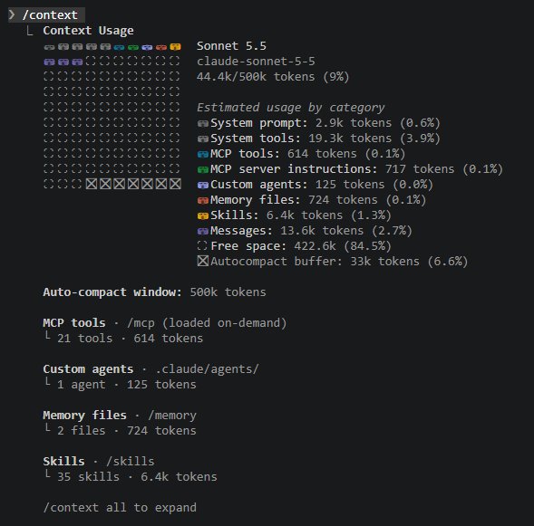
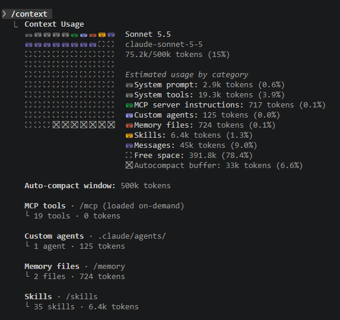
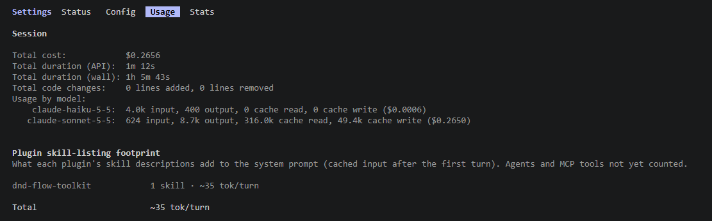
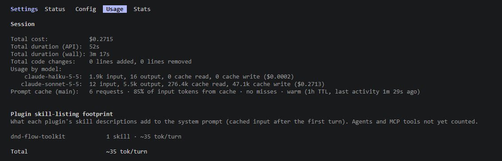

# Задача 9.2 — «Замір економії»

## Що порівнювалося

Огляд останніх змін HP-логіки у двох чистих сесіях Claude Code на Sonnet 5.5 — по одному запиту в кожній: один прогін із reviewer-субагентом, другий — без делегування. Для no-agent прогону опис субагента та його інструкції були додані безпосередньо до промпту, щоб передати ті самі правила рев'ю без делегування.

## Зрізи головного контексту

| Варіант | Фінальний `/context` | Повідомлення в контексті | Доказ |
|---|---:|---:|---|
| Із субагентом | 44.4k / 500k (9%) | 13.6k |  |
| Без субагента | 75.2k / 500k (15%) | 45.0k |  |

За фінальними зрізами головний контекст із субагентом менший на **30.8k токенів**, або приблизно **41%** від зрізу без субагента. Категорія `Messages` менша на **31.4k** (13.6k проти 45.0k). У no-agent варіанті інструкції рев'ю були частиною головного промпту; у варіанті із субагентом вони були передані агенту. У зрізі із субагентом видно 125 токенів опису custom agent — це лише overhead опису, не повний обсяг роботи агента.

## Загальні витрати за `/usage`

| Варіант | Вартість сесії | Токени за показаними категоріями | Доказ |
|---|---:|---:|---|
| Із субагентом | **$0.2656** | **≈379.1k** |  |
| Без субагента | **$0.2715** | **≈330.9k** |  |

Суми — сума показаних `input + output + cache read + cache write` для всіх моделей, на основі округлених значень:

- Із субагентом: Haiku `4.0k + 0.4k`; Sonnet `0.624k + 8.7k + 316.0k + 49.4k` = **≈379.1k**.
- Без субагента: Haiku `1.9k + 0.016k`; Sonnet `0.012k + 5.5k + 276.4k + 47.1k` = **≈330.9k**.

Прогін із субагентом має на **≈48.2k більше оброблених токенів**, хоча його вартість на **$0.0059 нижча** (`$0.2656` проти `$0.2715`). Тобто в цих замірах субагент зменшив контекст головної сесії, але не загальну кількість токенів.

## Транскрипт: прогін із субагентом

````text
Claude Code v2.1.323
Sonnet 5.5 with medium effort · Claude Pro
D:\foxminded\claude-code-pro-lab

❯ Please review the latest changes in project logic

● change-reviewer(Review latest logic changes)
Backgrounded agent (↓ to manage · ctrl+o to expand)

I've started the change-reviewer agent on the latest logic changes. That covers the HP rules, turn and order utilities, storage, types and their tests. It's still running, and I'll pass on its findings when it finishes.

✻ Waiting for 1 background agent to finish

● Agent "Review latest logic changes" finished · 1m 14s

The review of the HP-base changes on branch 002-hp-base found four issues, none of them blocking. The agent didn't run any tests, and I haven't checked its findings myself.

P2 — HP rules are duplicated outside src/hp.ts
- AddPlayerModal.tsx and storage.ts clamp maxHp and hp independently instead of using the HP helpers.
- The copies already differ on invalid and zero values.
- setPlayerHp takes an IPlayer rather than IGameDetails.

P2 — Editing Max HP can silently destroy data
- Blank or decimal Max HP falls back to 1, and Current HP is clamped to 1.
- Blank Current HP falls back to the maximum, which can heal a wounded character during an unrelated edit.

P3 — Enter in HpModal applies Damage
- Pressing Enter can apply damage when the user intended to heal.
- The footer also duplicates the Damage button.

P3 — An AddPlayerModal test name overstates its coverage
- The test title mentions blank or invalid Max HP, but the test only checks the Current HP cap.

What passed
- src/hp.ts follows the pure-function rule.
- src/utils.ts turn-order logic had no reported defects.
- The reviewer noted direct currentPlayer.maxHp reads in EditPlayerModal.tsx, but initially described them as probably acceptable.

Not reviewed
- The agent did not diff against main and had not read the changed test files.

I can fix any of these, or check the test files against the CLAUDE.md rules.
````
## Транскрипт: прогін без субагента

````text Claude Code v2.1.325
  Sonnet 5.5 with medium effort · Claude Pro
  D:\foxminded\claude-code-pro-lab


❯ Please review the latest changes in project logic. Without delagation.
  Determine the review scope yourself before inspecting code. Use Bash only for read-only Git inspection: git status --short --branch, git diff, git diff --cached, and git diff main...HEAD when a local main branch exists. Inspect both committed changes against main and staged/unstaged changes. If main is unavailable, report that limitation and review the staged/unstaged diffs. Use status to identify untracked files and inspect relevant ones with Read. If there are no changes to review, say so instead of guessing or reviewing broad areas of the repository.

  Read CLAUDE.md and applicable .claude/rules/ instructions for the changed files. Treat violations of explicit project rules as actionable findings even when the current behavior appears to work. Inspect every changed path in the Git scope, including test files, configuration, instructions, and relevant untracked files. Do not silently exclude a path as outside scope; if a path is irrelevant, briefly explain why. Use Read to inspect changed files and Grep to locate affected callers, references, and related tests. Verify behavior claims against the implementation, not only test expectations. If changed files are not readable or tests relevant to a source change are missing/not found, state that specifically. Do not run tests or other commands.

  Before reporting findings, make a coverage checklist from the Git scope and mark each changed path inspected or explain why it could not be inspected. Do not describe the review as complete, say that the findings stand, or recommend fixes while any path in scope remains unchecked; label it INCOMPLETE and identify the remaining paths instead. Return findings first only after this gate passes. For each finding, include a priority (P1–P3), file and line, the concrete failure scenario, and why the change causes it. If there are no findings, say so and briefly state the scope reviewed. End with the coverage checklist, including source, tests, configuration/instruction files, untracked relevant files, and whether tests were run (they must not be run). Do not propose or apply code edits. Bash is limited to the read-only Git inspection commands above; do not use it to run tests or modify files.

  Searched for 1 pattern, read 1 file, ran 5 shell commands
2 actions not run · permission denied

Bash is limited to Git inspection, so I'll switch to Read and Grep.

  Searched for 1 pattern, read 3 files

Findings

P2: HP rules live in components instead of src/hp.ts. CLAUDE.md says HP rules go in src/hp.ts as pure functions that take and return IGameDetails. The branch puts the same clamp-and-default logic in three more places:
- AddPlayerModal.tsx:60-66 has its own Math.max(1, …), ?? parsedMaxHp and Math.min(Math.max(hp, 0), max).
- EditPlayerModal.tsx:51-52 has its own ?? 1 and ?? maxHp defaults.
- storage.ts:50-52 re-implements the same validation.

The failure scenario is that the three copies already differ. Add treats a Max HP of 0 as 1. Edit passes 0 to setPlayerHp, which also gives 1. Add and Edit both turn a blank Current HP into full HP. Storage keeps an invalid hp of -1 as full HP, but a valid hp of 0 stays 0. A later rule change, such as temp HP or a different minimum, has to be made in all three places or they drift apart. setPlayerHp also takes an IPlayer, not IGameDetails, so it doesn't follow the stated signature.

P2: maxHp is read directly, not through getMaxHp(player). EditPlayerModal.tsx:25 and EditPlayerModal.tsx:35 use currentPlayer.maxHp. This breaks the explicit CLAUDE.md rule that the maximum is read only through getMaxHp. It breaks the behavior as well as the rule. If getMaxHp later adds a modifier, the edit form will show and save the raw base value.

P3: Clearing Current HP in the edit form refills the player to full. At EditPlayerModal.tsx:52, a blank or decimal Current HP becomes maxHp. A user who clears the field to retype loses the player's real HP if they save too early. A blank value should probably keep the existing HP, as it does for other blank fields. SetupStage.test.tsx covers a valid edit and the cap at Max HP. It doesn't cover a blank Current HP.

P3: One AddPlayerModal test doesn't test what its name says. AddPlayerModal.test.tsx has a test titled "caps Current HP at Max HP and turns a blank or invalid Max HP into 1". It only checks the cap (Max HP 5, Current HP 9 gives 5/5). The blank and invalid Max HP branch at AddPlayerModal.tsx:60 has no coverage.

P3: The .claude/settings.json allowlist is broader than the project rules. The branch adds Bash(yarn lint *) and Bash(yarn test *). CLAUDE.md says yarn lint uses --fix, so this pre-approves a command that rewrites files, with arbitrary arguments. The project's non-fixing lint command is npx eslint <files>.

P3: The HP button has no accessible context. In PlayerRow.tsx:48-58, the button's text is just 12/20, and the tests find it by that text. Screen readers and touch users get no hint that it opens a damage/heal dialog. This is a small accessibility gap.

Checked and found fine


One thing is by design and not a defect: a player at 0 HP isn't skipped in turn order, because the branch only marks them visually as down.

Coverage checklist

Scope: the testing branch against local main (committed changes). There are no staged or unstaged changes, and one untracked path.

┌──────────────────────────────────────────────────────────────────────────────────────────────────────────┬───────────────────────────────────────────────────────────────────────┐
│                                                   Path                                                   │                                Status                                 │
├──────────────────────────────────────────────────────────────────────────────────────────────────────────┼───────────────────────────────────────────────────────────────────────┤
│ CLAUDE.md                                                                                                │ inspected                                                             │
├──────────────────────────────────────────────────────────────────────────────────────────────────────────┼───────────────────────────────────────────────────────────────────────┤
│ .claude/settings.json                                                                                    │ inspected                                                             │
├──────────────────────────────────────────────────────────────────────────────────────────────────────────┼───────────────────────────────────────────────────────────────────────┤
│ .claude/agents/change-reviewer.md (untracked)                                                            │ inspected; it's the reviewer config and not app logic, so no findings │
├──────────────────────────────────────────────────────────────────────────────────────────────────────────┼───────────────────────────────────────────────────────────────────────┤
│ src/types.ts, src/hp.ts, src/storage.ts, src/testUtils.ts                                                │ inspected                                                             │
├──────────────────────────────────────────────────────────────────────────────────────────────────────────┼───────────────────────────────────────────────────────────────────────┤
│ AddPlayerModal.tsx, EditPlayerModal.tsx, HpModal.tsx and its styles.module.scss                          │ inspected                                                             │
├──────────────────────────────────────────────────────────────────────────────────────────────────────────┼───────────────────────────────────────────────────────────────────────┤
│ CombatStage.tsx, SetupStage.tsx, PlayersTable.tsx                                                        │ inspected                                                             │
├──────────────────────────────────────────────────────────────────────────────────────────────────────────┼───────────────────────────────────────────────────────────────────────┤
│ PlayerRow.tsx and its styles.module.scss                                                                 │ inspected                                                             │
├──────────────────────────────────────────────────────────────────────────────────────────────────────────┼───────────────────────────────────────────────────────────────────────┤
│ src/App.test.tsx, src/utils.test.ts, src/hp.test.ts, src/storage.test.ts                                 │ inspected                                                             │
├──────────────────────────────────────────────────────────────────────────────────────────────────────────┼───────────────────────────────────────────────────────────────────────┤
│ AddPlayerModal.test.tsx, CombatStage.test.tsx, HpModal.test.tsx, PlayerRow.test.tsx, SetupStage.test.tsx │ inspected                                                             │
├──────────────────────────────────────────────────────────────────────────────────────────────────────────┼───────────────────────────────────────────────────────────────────────┤
│ Supporting files read: Modal.tsx, utils.ts (parseNumberInput, createPlayer)                              │ inspected                                                             │
└──────────────────────────────────────────────────────────────────────────────────────────────────────────┴───────────────────────────────────────────────────────────────────────┘

Review status: complete, with every path in scope inspected. I didn't run tests or any other commands, and used only read-only Git commands. I made no edits.

✻ Baked for 57s · done 20:12
````

## Обмеження заміру

Обидва прогони виконані в чистих сесіях, по одному запиту в кожній. No-agent запит містив опис субагента та його інструкції як звичайний текст, тож завдання й правила рев'ю були ті самі, а відрізнялося делегування. Початкові `/context` зрізи не знімалися: наведене порівняння є порівнянням кінцевого заповнення, не приросту від старту. `/usage` totals належать окремим сесіям, по одному запиту в кожній, і включають витрати головної моделі та субагента, якщо він викликався.

## Висновок

У цих двох чистих прогонах головна сесія з субагентом використала на **30.8k токенів контексту менше** (44.4k проти 75.2k). Загалом `/usage` показав **≈379.1k токенів і $0.2656** для варіанта із субагентом та **≈330.9k і $0.2715** без нього. Отже, субагент зменшив контекст головної сесії, але витратив приблизно на 48.2k більше загальних токенів; доларова вартість була на $0.0059 нижчою.

