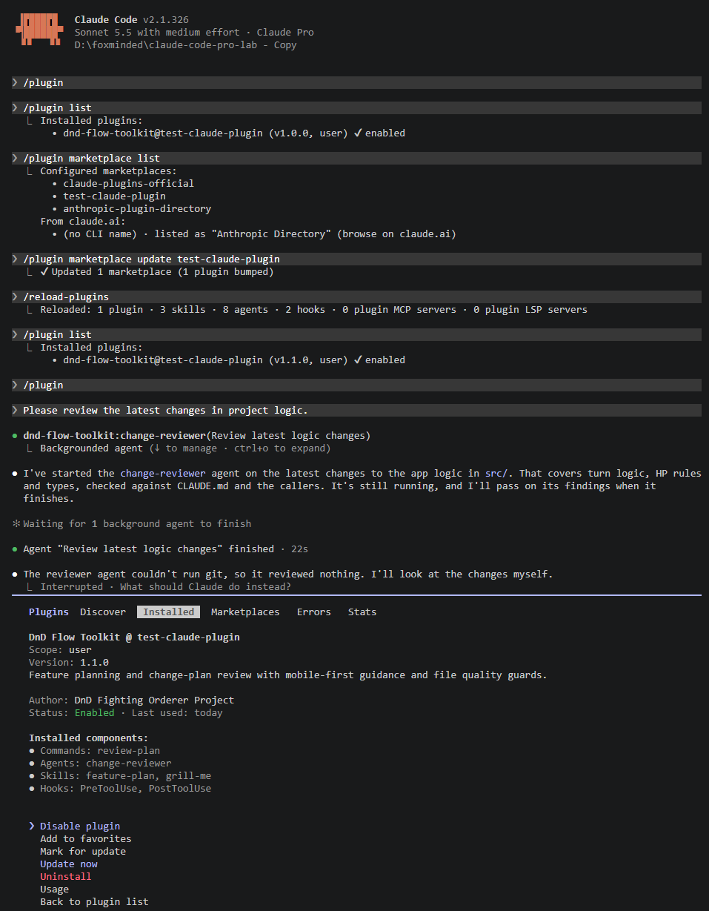

# Задача 9.4 — «Оновити плагін»

## Зміна

До dnd-flow-toolkit додано change-reviewer. Порівняно з агентом 9.1 збережено його тригер і coverage checklist; permissionMode: plan прибрано, бо plugin subagents його ігнорують. Додано disallowedTools: Edit, Write та окремий plain-language Diff summary. Модель sonnet і tools: Read, Grep, Bash збережені. Версію піднято до 1.1.0.

Опублікований commit: [e736b2220acb08d3fe35cb47a1d25030f7b863f0](https://github.com/MykolaKroshko/test-claude-plugin/commit/e736b2220acb08d3fe35cb47a1d25030f7b863f0).

## Оновлення в копії проєкту

У сесії з копії проєкту marketplace оновлено, а плагін перезавантажено. Версія змінилася з 1.0.0 на 1.1.0; scope — user. Список компонентів показав change-reviewer.

## Доказ

**Результат:** субагент спрацював без згадки назви, але виконання було зупинене вручну до завершення review. Тому скриншот підтверджує делегування, але не завершену перевірку чи її результати.

